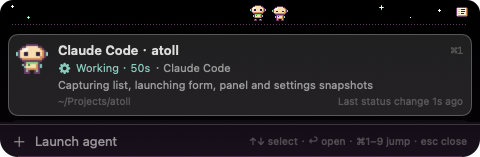
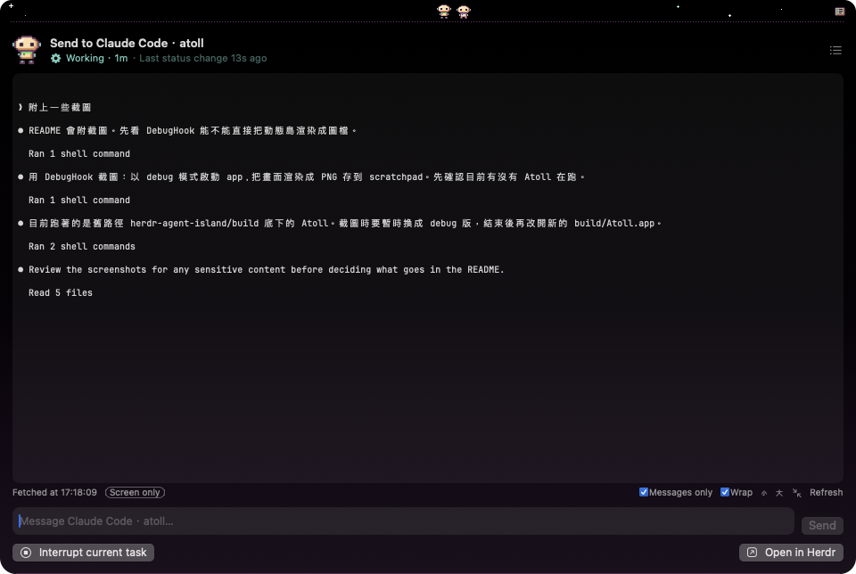
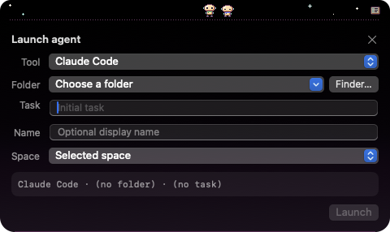
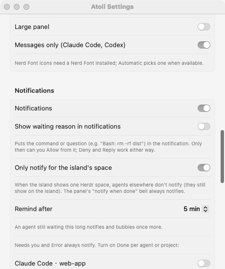
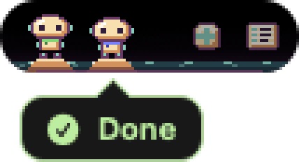
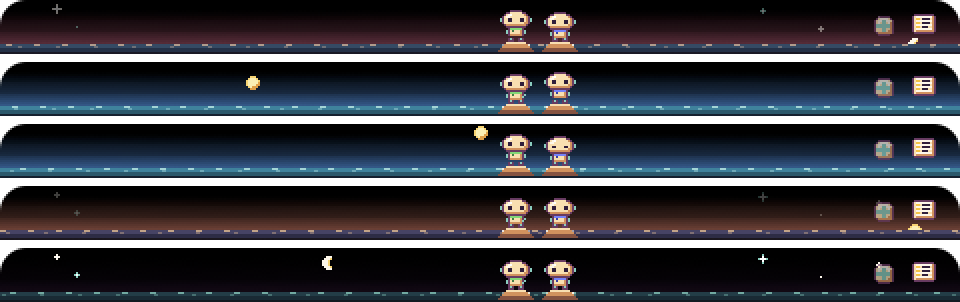
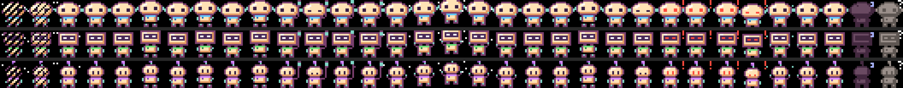

# Atoll

在 macOS 螢幕頂部（與瀏海融合）顯示像素風「動態島」，即時呈現本機所有 AI coding agent（Claude Code、Codex）的狀態，並能直接回覆、中斷或切回原本的終端機。


同時跑多個 agent 時，不用逐一切視窗查看誰在工作、誰在等你回覆、誰出錯了：每個 agent 是站在自己小沙洲上的小機器人，需要注意的永遠釘在最顯眼的位置。

> 自用工具：ad-hoc 簽章、未 notarize，不對外發佈。

## 功能

- **監看**：每個 agent 一個角色，外觀代表工具、個體色在 session 內固定；動畫之外一律附圖示與文字（Working / Needs you / Done / Idle / Error / Exited / Unknown）。等待使用者與錯誤的 agent 釘在左翼，其餘依優先級排列。沒有 agent 時顯示無人小島圖示。
- **環礁場景**：動態島背景是一片環礁，每個 agent 站在自己的沙洲上，海浪流動、偶爾有魚跳出水面；等待你或出錯的 agent 腳下水面會映出黃光／紅光。天空、海水與日月依本機時間從黎明、白天、黃昏變化到深夜。設定裡關掉 Decorations 即回到純黑。
- **清單**：點動態島空白處或按 `⌥⌘A` 展開，依「等待使用者 > 錯誤 > 狀態未知 > 執行中 > 完成／閒置」排序。`↑↓` 選擇、`Enter` 打開、`⌘1`–`⌘9` 直接跳、`Esc` 逐層返回。展開後點 island 以外的地方會自動收起；按清單、面板或啟動表單上的釘選（📌）可以保持展開，Esc、點標題列與快捷鍵仍可收起，收起後釘選自動解除。
- **互動面板**：看近期終端機輸出、傳送訊息、回答 `blocked: question`、用按鍵排回應 permission prompt、中斷目前任務（1.5 秒內二次確認），或一鍵切回原終端機接手。送出狀態明確區分 Delivered / Agent started / Sent · unconfirmed / Failed，永不自動重送。回應完一個等待中的 agent、它確實離開等待後，面板自動切到下一個等最久的 agent（輸入框有未送出文字時不切），全部處理完顯示 All clear；標題列顯示還有幾個在等，`⌘]` 手動跳下一個。可在設定關閉自動切換。輸入框下方有快速回覆按鈕（預設「繼續」「照你的建議做」「跑測試，失敗就修到通過」，設定中可編輯，最多 5 個），點擊或 `⌘⇧1`–`⌘⇧5` 直接送出，⌥-點擊先放進輸入框修改。agent 還在 Working 時可以按 Queue（`⌥↩`）先排下一步，這個回合結束（Done，或停成 Idle）才送出，只送一次；中途 Needs you 不會拿它去回答，出錯時保留等你決定送出或取消，agent 退出就丟棄。排隊中的訊息顯示在輸入框上方（可 Edit／Cancel），清單與 hover card 標示 Queued，送出時冒泡泡；送不出去時文字放回輸入框。排隊訊息只在記憶體，Atoll 結束即丟棄。
- **今日時間軸**：選單列「Today…」或清單底列的「Today」在動態島展開 Today 窗格（同清單與啟動表單，`Esc` 回清單），依時間倒序列出今天每個回合結束的時間、agent、狀態、變更量與最後一句話，可依 agent 篩選；還沒打開過該 agent 面板的回合有一個點，標題列顯示未看數；點一列打開該 agent 的面板，已不在的 agent 標示 Gone。只保留今天（本機時間 00:00 起）最多 200 筆，只在記憶體。
- **輸出搜尋**：面板按 `⌘F` 在終端機輸出上方打開搜尋列，不分大小寫比對畫面上顯示的文字（Messages only 打開時就是過濾後的內容），所有符合處高亮、顯示「3 / 12」；`↩`／`⇧↩` 下一個／上一個（到底循環），`Esc` 先關搜尋列、再按一次才返回清單。只搜尋已經讀進來的輸出，自動刷新時保留關鍵字並停在同一行附近；換 agent 或關閉面板就清掉。
- **指令補完**：面板輸入框與啟動表單的 Task 欄位打 `/` 會列出符合的 slash command 與 skill（Codex 另外支援句中打 `$` 提及 skill），附參數提示、描述與來源（built-in／user／project／plugin）。`↑↓` 選擇、`Tab` 補完、`Esc` 關閉；`Return` 補完選取項，已經打完整名稱時直接送出。清單從磁碟讀取：Claude Code 的內建指令與 bundled skill、`~/.claude/skills|commands`、從 agent 工作目錄往上到 repo root 的 `.claude/skills|commands`、已啟用 plugin 的 skill 與 command；Codex 的內建指令、`~/.agents/skills`、`~/.codex/skills`、repo 的 `.agents/skills`。session 開始後才新增或停用的項目可能和 agent 實際載入的不一致，只用來補字，不會自動送出。
- **等待原因預覽**：清單列與 hover card 直接顯示 Needs you 的 agent 在等什麼，例如 `Bash: touch hello.txt`、Codex 的 `Run: …` 加上理由，或問題與選項，多數情況不用打開面板就能決定怎麼回。permission 對話框認得版面時，清單列直接有 Allow／Deny（選取列 `⌘Y`／`⌘N`），按鍵從畫面上的選項推出（Allow 只對應單次的「Yes」，不提供「don't ask again」）；送出前 agent 已經離開那個對話框就不送，顯示「No longer waiting」。herdr-core 對 Claude Code 會提供等待原因，直接使用；herdr CLI、cmux，以及 Codex（任何來源都沒有）則在進入 Needs you 後讀一次畫面擷取，只認得 Claude Code 與 Codex 已知的對話框版面，認不得就不顯示。
- **最後一句話**：agent 跑完一個回合時，清單列與 hover card 顯示它最後說的話，泡泡在變更量下面多一行，不打開面板就能判斷要不要回。herdr-core 對 Claude Code 會提供一句摘要，直接使用；Codex、herdr CLI 與 cmux 沒有，就在回合結束時讀一次畫面，取最後一段回覆（Claude Code 的 `⏺`、Codex 的 `•` 區塊）的最後 2 行；回合最後是工具呼叫、或認不得版面時不顯示。下一個回合開始就清掉。
- **成果摘要**：agent 跑完一個回合（Done／Exited，或從 Working 直接停成 Idle）時，在它的專案目錄用 git 算出這個回合的變更量，例如 `+120 −30 · 6 files · 1 new`，顯示在泡泡、清單、hover card 與面板標題列。以回合開始時的 commit 為基準，agent 自己 commit 的也算進去；回合開始時已有未 commit 的修改會標「incl. earlier edits」，Atoll 沒看到回合開始時標「uncommitted」，同一個 working tree 還有其他 agent 時標「shared tree」。面板標題列的摘要可以點開：列出這個回合變更的檔案（M／A／D／R、未追蹤的新檔標 N）與各自的 `+N −M`，點檔案展開 diff（單檔超過 500 行截斷），或用預設 app 打開檔案；diff 的基準與摘要相同。這裡的 git 只做唯讀查詢（`--no-optional-locks`，每個指令 2 秒逾時），非 git 目錄不顯示。可在設定關閉。
- **No output 提示**：agent 停在 Working、畫面卻很久沒有變化時（預設 10 分鐘，設定可選 5／10／20 分鐘或關閉），清單、hover card 與面板標題列在狀態後標示「No output for 12m」，只陳述畫面沒變，不推測卡住。來源都沒有「有新輸出」的事件，所以 Atoll 對 Working 的 agent 每 2 分鐘讀一次畫面算雜湊，算之前先去掉輸入框、狀態列、spinner、計時與 token 計數、閃爍的 `⏺` 與 Claude Code 會定期改寫的工具標題；全部 agent 合計每分鐘最多讀 10 次，agent 多時間隔自動拉長。不發通知、不冒泡泡。
- **共用 working tree 警示**：兩個以上活動中（Starting／Working／Needs you／Error）的 agent 在同一個 git working tree 時，清單、hover card 與面板標題列標示「Shares working tree with …」，提醒改用各自的 worktree。不同的 `git worktree` 不會被誤判；每個專案路徑只用 `git rev-parse --show-toplevel` 查一次，不輪詢。新的 agent 加入時冒一次泡泡，同一組 agent 之後輪流開始、結束回合不會重複冒；整組少於兩個 agent 後重新計算。可在設定關閉。
- **啟動**：點動態島上的「＋」（或清單底部的 Launch agent），透過 Herdr 開新的 Claude Code、Codex 或 herdr-core template agent。選的目錄是 git repo 時可勾「New worktree」：先在 repo 旁邊的 `<repo>.worktrees/<slug>` 用 `git worktree add -b atoll/<slug>` 從目前的 HEAD 開新 branch，再在裡面（同一個子目錄）啟動；branch 名稱可改，已存在會要你換名，repo 有未 commit 的修改時會提醒不會帶過去。這是 Atoll 唯一會寫入 repo 的 git 操作，同樣停用 hooks 與 filter driver（所以 `post-checkout` 不會跑，Git LFS 檔案會是 pointer）；Atoll 不負責刪除 worktree。共用 working tree 警示旁的「Launch in new worktree」會直接打開預填好的表單。表單記住最近 10 次成功送出的組合（工具、目錄、任務、名稱、space、是否 New worktree），右上角「Recent」選了只填入表單，「Launch again」（`⌘R`）帶回最近一筆、仍要按 Launch 確認；常用組合可以「Save as preset…」存成具名 preset（最多 20 個，Settings 可改名、排序、刪除）。Presets 是 Atoll 自己的表單預設，和工具選單裡的 herdr-core template 不同。帶回時目錄不存在就留空、template 不存在就改回預設工具，都會提示；New worktree 只在目錄仍是 repo 時開啟，branch 一律重新產生。
- **對話泡泡**：agent 停下來（Done／Idle／Exited）、等待你或出錯時，該角色下方冒出約 5 秒的狀態泡泡；一次一個，等待與錯誤優先，點泡泡直接打開面板。可在設定關閉。
- **全螢幕與多螢幕**：動態島所在螢幕有 app 全螢幕時，預設只顯示等待你或出錯的 agent，沒有就整個隱藏（可改為照常顯示或一律隱藏）；快捷鍵仍可展開清單。螢幕可選 Follow mouse，動態島跟著游標換螢幕，展開時不移動。
- **通知**：agent 等待你或出錯時發 macOS 通知，內容只有「工具 · 專案名」；`⌃⌥⌘A` 直接打開最早開始等待的 agent。等待超過設定時間（預設 5 分鐘，可關閉）仍沒處理會再提醒一次，泡泡也再冒一次。面板上的鈴鐺可設定「這次跑完時通知我」，通知一次後自動關閉。Needs you 的通知可以直接回應：permission 有 Deny，question 有 Reply；設定裡打開「Show waiting reason in notifications」（預設關閉）後通知會附上指令或問題，才會出現 Allow，避免在看不到指令的地方核准。按下時 agent 已經不在那個對話框就不送，改發「No longer waiting」；Reply 沒送出時點通知會打開面板並帶回你打的字。
- **誠實的狀態**：來源斷線或超過 heartbeat 期限時，動態島轉灰並標示「狀態未知」，不從畫面文字猜測狀態。
- **隱私**：只和本機的 herdr-core、herdr CLI、cmux 溝通；指令補完只在本機讀取上述 skill／command 定義檔與 plugin 設定，不寫入也不外傳；近期輸出與回合變更的 diff 只在面板開著時留在記憶體。例外是等待原因預覽與回合的最後一句話：都只保留擷取出來的最多 2 行，前者在 agent 離開 Needs you、後者在下一個回合開始或 agent 被移除時丟棄，都不寫入磁碟；回合的最後一句話不會放進通知；今日時間軸會保留每個回合的最後一句話（同樣最多 2 行）與變更量，直到 Atoll 結束、換日或按「Clear」，只在記憶體、不寫入磁碟，Settings 可關閉；No output 提示只保留畫面的雜湊；啟動表單的最近紀錄與 presets（含任務文字）會存在本機 UserDefaults，Settings 可「Clear recent launches」；只有打開「Show waiting reason in notifications」時，預覽的第一行才會出現在 macOS 通知裡。

| 清單 | 互動面板 |
| --- | --- |
|  |  |

| 啟動 agent | 設定 |
| --- | --- |
|  |  |

| 對話泡泡 | 一天的環礁（黎明 → 白天 → 正午 → 黃昏 → 深夜） |
| --- | --- |
|  |  |

角色是原生 16×16 的像素小機器人（Claude Code／Codex／通用三種頭型），每個狀態有對應動畫：



## 支援的 agent 來源

| 來源 | 讀取方式 |
| --- | --- |
| herdr-core（Herdr app） | 直接連 core 的 Unix socket（JSON-RPC 2.0），訂閱事件串流 |
| herdr CLI／TUI | `~/.config/herdr/herdr.sock`，`agent.list` 輪詢＋pane 事件 |
| cmux | `cmux events` 的 `agent.hook.*` 事件；cmux 沒開時不呼叫任何 cmux 指令 |
| 其他終端機（Ghostty、iTerm、VS Code…） | 選用：source `scripts/shell/atoll.zsh`，把 `claude`／`codex` 改經 `hc run` 執行 |

前三者不需要改任何 shell 設定。在其他終端機使用時，於 `~/.zshrc` 加入：

```zsh
source /path/to/atoll/scripts/shell/atoll.zsh
```

來源 app 會自動偵測；偵測錯誤時可用 `export ATOLL_ORIGIN=<bundle id>` 覆寫。

## 需求

- macOS 15 以上（Apple Silicon 驗證過）
- Swift 6 toolchain（Xcode 16 以上或 Command Line Tools）
- 至少一個 agent 來源：herdr-core（驗證版本 `hc` 0.1.20 ＋ Herdr app 0.1.14）、herdr CLI 0.9.x 或 cmux
- 啟動 agent 與「Open in Herdr」需要 Herdr app 執行中

## 建置與執行

```sh
./scripts/build-app.sh          # 產出 build/Atoll.app（release、ad-hoc 簽章）
open build/Atoll.app
```

Atoll 是 menu bar app（`LSUIElement`），沒有 Dock 圖示；從 menu bar icon 開關動態島、打開設定或結束。

開發時可用 debug hook 重建並重啟（會把畫面渲染到 `$ATOLL_DEBUG_DIR/*.png`，並讀取 `$ATOLL_DEBUG_DIR/cmd` 的指令，見 `Sources/Atoll/DebugHook.swift`）：

```sh
ATOLL_DEBUG_DIR=/tmp/atoll-debug ./scripts/dev-run.sh
```

## 測試

```sh
swift test                                        # AtollCore 單元測試（fake client，不需任何後端）
HERDR_CONTRACT=1 swift test --filter Contract     # 對本機真實 herdr-core 的契約測試
```

契約測試預設不跑，只做唯讀操作與自己建立、自己清除的測試 terminal。herdr-core 協定仍是 preview，升級後應重跑。

## 專案結構

```
Sources/
  AtollCore/   領域核心：各來源 adapter（CoreRPC／HerdrCLI／Cmux）、AgentStore（狀態對映、排序、送出／啟動狀態機）、通知規則
  Atoll/       App：動態島 NSPanel、SwiftUI 視圖、SpritePlayer、menu bar、設定、全域快捷鍵
    Resources/Sprites/   sprite sheet（PNG + Aseprite 風格 JSON）
Tests/AtollCoreTests/    Swift Testing，以 fake HerdrClient 驗證 AgentStore 行為
scripts/                 build-app.sh、dev-run.sh、shell 包裝、占位 sprite 產生器
.scratch/atoll/          spec、issues（ticket 01–26）、美術探索與定稿
```

所有業務邏輯都在 `AtollCore`（不依賴 AppKit／SwiftUI）；UI 只讀 `AgentStore` 的狀態並轉發使用者意圖。

## 文件

- [`spec.md`](.scratch/atoll/spec.md)：P0 規格、狀態對映、協定細節與已驗證事實
- [`issues/`](.scratch/atoll/issues/)：實作 tickets（目前 01–26 皆已完成）
- [`art/`](.scratch/atoll/art/)：風格探索 board 與 B / Toy Chunky 定稿美術
