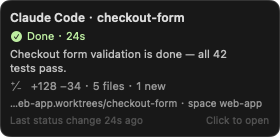
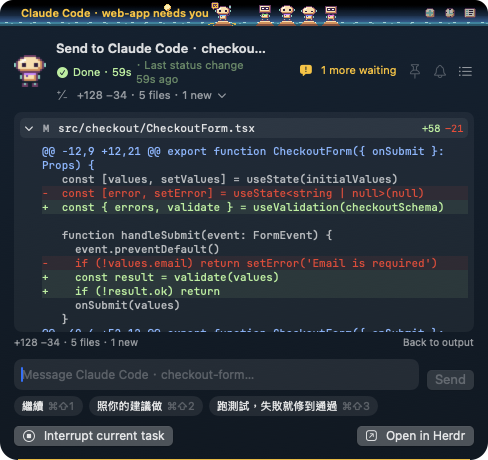
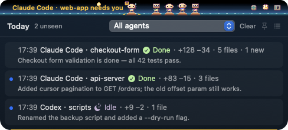

# Atoll

macOS 瀏海上的像素風「動態島」，即時顯示本機所有 AI coding agent（Claude Code、Codex）的狀態，並能直接回覆、核准、中斷或切回原本的終端機。


同時跑多個 agent 時不用逐一切視窗：每個 agent 是站在自己沙洲上的小機器人，等你回覆或出錯的永遠釘在最顯眼的位置。

> 截圖都是 demo 模式（`ATOLL_DEMO=1`）的虛構資料，見[建置與執行](#建置與執行)。

> 自用工具：ad-hoc 簽章、未 notarize，不對外發佈。

## 功能

### 監看

- 每個 agent 一個像素角色，頭型代表工具（Claude Code／Codex／通用），個體色在 session 內固定
- 七種狀態：Working／Needs you／Done／Idle／Error／Exited／Unknown，動畫之外一律附圖示與文字
- Needs you 與 Error 釘在左翼並顯示提示文字，其餘依優先級排在右翼
- 等待原因預覽：直接顯示 agent 在等什麼（例如 `Bash: touch hello.txt`、問題與選項）
- 最後一句話：回合結束時顯示 agent 最後說的話（最多 2 行）
- 成果摘要：回合結束時用 git 算出變更量（`+120 −30 · 6 files · 1 new`），可點開看檔案清單與 diff
- No output 提示：Working 但畫面很久沒變時標示「No output for 12m」（預設 10 分鐘，可調整或關閉）
- 共用 working tree 警示：兩個以上活動中的 agent 在同一個 git working tree 時提醒，並提供「Launch in new worktree」
- 來源斷線或超過 heartbeat 期限時轉灰、標示「狀態未知」，不從畫面文字猜測狀態

滑鼠停在角色上會顯示 hover card：狀態、最後一句話、變更量、路徑與所在的 space。



### 清單與 Spaces

- 點動態島空白處或按 `⌥⌘A` 展開，依「Needs you > Error > Unknown > Working > Done／Idle」排序
- 依 Herdr space 分段（含 sub-agent），有人在等你的 space 排最前；不在任何 space 的歸「Other」，沒有 space 時維持平鋪
- 清單頂端的 Island 列（或 `Tab`／`⇧Tab`）切換收合的動態島只顯示某個 space，右翼標示 space 名稱與藏起來的數量（「atoll +3」）；其他 space 的 Needs you／Error 仍會顯示
- 可辨識的 permission 對話框直接在清單列 Allow／Deny（只對應單次的「Yes」，不提供「don't ask again」）
- 釘選（📌）讓展開狀態不因點擊其他地方而收起

清單依 space 分段：web-app 裡有一個 agent 在等 permission，可以直接 Allow／Deny；完成的 agent 附上最後一句話與變更量。頂端的 Island 列決定收合的動態島顯示哪個 space。


切到 web-app 之後，收合列只剩這個 space 的角色，前面標示「web-app +3」（另外 3 個被藏起來）：


### 互動面板

- 看近期終端機輸出（可切 Messages only：認得 Claude Code、Codex、OpenCode 的版面；大面板、調整字型），`⌘F` 搜尋並高亮
- 傳送訊息、回答問題、用按鍵回應 permission prompt、中斷任務（1.5 秒內二次確認）、一鍵切回原終端機
- 送出狀態區分 Delivered／Agent started／Sent · unconfirmed／Failed，永不自動重送
- 快速回覆按鈕（最多 5 個、可編輯），`⌘⇧1`–`⌘⇧5` 直接送出，⌥-點擊先放進輸入框
- Queue（`⌥↩`）：agent 還在 Working 時先排下一步，回合結束才送出一次
- 指令補完：打 `/` 列出 slash command 與 skill（Codex 另支援 `$`），從本機的 user／project／plugin 定義讀取
- 回應完一個等待中的 agent 後自動切到下一個等最久的（輸入框有未送出文字時不切），`⌘]` 手動跳
- 面板上的鈴鐺：「這次跑完時通知我」，通知一次後自動關閉

| 輸出搜尋與按鍵回應 | 回合變更的檔案與 diff |
| --- | --- |
|  |  |

### 啟動 agent

- 從動態島的「＋」透過 Herdr 開新的 Claude Code、Codex 或 herdr-core template agent；另會在 login shell 偵測已安裝的 OpenCode、GitHub Copilot CLI、Factory Droid、Qwen Code、Cursor Agent、Kimi Code CLI，有裝才列出（以通用角色顯示；Kimi 不支援帶 initial task）
- New worktree：在 `<repo>.worktrees/<slug>` 開新 branch（`atoll/<slug>`）再啟動
- Space 預設跟著動態島選的 space（從 agent 的「Launch in new worktree」進來則用該 agent 的 space），其次是 Settings 的 Default space
- 「New space…」開新的 Herdr space 並可自訂名稱（留白則依資料夾命名）
- Herdr app 沒開也能啟動：agent 直接在 herdr-core 跑起來（`hc run` 加上 Herdr 的 space／tab label），app 打開後出現在指定的 space；space 清單來自上次 app 開著時的快取與 terminal label，新 space 的名稱等 app 打開時才套用
- Recent 記住最近 10 次組合，`⌘R`「Launch again」帶回最近一筆；常用組合可存成 preset（最多 20 個）

動態島切在 web-app 時打開表單，Space 預設就是 web-app 並標示「from island」：


### 今日時間軸

- 點動態島的時鐘按鈕展開 Today 窗格，依時間倒序列出今天每個回合的結束時間、agent、狀態、變更量與最後一句話
- 可依 agent 篩選，未看過的回合有標記，點一列打開該 agent 的面板
- 只保留今天最多 200 筆，只在記憶體



### 提醒與通知

- 對話泡泡：agent 停下、等待你或出錯時，角色下方冒出約 5 秒的泡泡，點了直接打開面板
- macOS 通知：等待你或出錯時發送，內容只有「工具 · 專案名」；`⌃⌥⌘A` 打開最早開始等待的 agent
- 等待超過設定時間（預設 5 分鐘）再提醒一次
- 可設定只通知動態島目前的 space（其他 space 的 agent 仍顯示在動態島；面板鈴鐺照常通知）
- 通知可直接回應：permission 有 Deny、question 有 Reply；打開「Show waiting reason in notifications」後才附上指令並提供 Allow

| 對話泡泡 | Settings › Notifications |
| --- | --- |
|  |  |

### 外觀與顯示

- 環礁場景：海浪、跳魚，天空與日月依本機時間從黎明變化到深夜；等待／出錯的 agent 腳下映出黃光／紅光（可關閉 Decorations 回到純黑）
- 全螢幕時預設只顯示需要注意的 agent，沒有就隱藏（可改為照常顯示或一律隱藏）
- 多螢幕可指定螢幕或 Follow mouse

一天的環礁（黎明 → 白天 → 正午 → 黃昏 → 深夜）：


角色是原生 16×16 的像素小機器人，每個狀態有對應動畫：


## 快捷鍵

| 範圍 | 按鍵 | 動作 |
| --- | --- | --- |
| 全域 | `⌥⌘A` | 展開／收起清單（可在設定更改） |
| 全域 | `⌃⌥⌘A` | 打開最早開始等待的 agent（可在設定更改） |
| 清單 | `↑` `↓`（或 `⌃P` `⌃N`）／ `↩` | 選擇／打開面板 |
| 清單 | `⌘1`–`⌘9` | 直接打開第 N 個 agent |
| 清單 | `⌘Y` ／ `⌘N` | 對選取列 Allow／Deny |
| 清單 | `Tab` ／ `⇧Tab` | 切換動態島顯示的 space |
| 面板 | `⌘F` | 搜尋輸出（`↩`／`⇧↩` 上下一個） |
| 面板 | `⌥↩` | Queue 訊息 |
| 面板 | `⌘⇧1`–`⌘⇧5` | 送出快速回覆 |
| 面板 | `⌘]` | 跳到下一個等待中的 agent |
| 面板 | `⌘+` `⌘-` `⌘0` | 調整輸出字型大小 |
| 補完選單（回覆框、Task 欄位） | `↑` `↓`（或 `⌃P` `⌃N`）／ `Tab` ／ `↩` ／ `Esc` | 選擇／補完／選用／關閉 |
| 啟動表單 | `⌘R` | Launch again |
| 任何窗格 | `Esc` | 逐層返回（搜尋列 → 面板 → 清單 → 收起） |

## 隱私

- 只和本機的 herdr-core、herdr CLI、cmux 溝通，不外傳任何資料
- 終端機輸出與 diff 只在面板開著時留在記憶體
- 從畫面擷取的文字只保留最多 2 行（等待原因、最後一句話），不寫入磁碟；今日時間軸同樣只在記憶體，Atoll 結束、換日或按 Clear 即丟棄
- No output 提示只保留畫面雜湊
- git 只做唯讀查詢；唯一的寫入是使用者勾選的 New worktree（停用 hooks 與 filter driver）
- 啟動表單的 Recent 與 presets（含任務文字）存在本機 UserDefaults，可在 Settings 清除
- 通知預設只有「工具 · 專案名」；只有打開「Show waiting reason in notifications」才會附上指令或問題

## 支援的 agent 來源

| 來源 | 讀取方式 |
| --- | --- |
| herdr-core（Herdr app） | 直接連 core 的 Unix socket（JSON-RPC 2.0），訂閱事件串流；space 從 `herdr-app ls` 讀取 |
| herdr CLI／TUI | `~/.config/herdr/herdr.sock`，`agent.list` 輪詢＋pane 事件 |
| cmux | `cmux events` 的 `agent.hook.*` 事件；cmux 沒開時不呼叫任何 cmux 指令 |
| 其他終端機（Ghostty、iTerm、VS Code…） | 選用：source `scripts/shell/atoll.zsh`，把 `claude`／`codex` 改經 `hc run` 執行 |

前三者不需要改任何 shell 設定。在其他終端機使用時，於 `~/.zshrc` 加入：

```zsh
source /path/to/atoll/scripts/shell/atoll.zsh
```

來源 app 會自動偵測；偵測錯誤時可用 `export ATOLL_ORIGIN=<bundle id>` 覆寫。

等待原因與最後一句話：herdr-core 對 Claude Code 會直接提供；其他來源與 Codex 則在進入 Needs you 或回合結束時讀一次畫面擷取，只認得 Claude Code 與 Codex 已知的版面，認不得就不顯示。

## 需求

- macOS 15 以上（Apple Silicon 驗證過）
- Swift 6 toolchain（Xcode 16 以上或 Command Line Tools）
- 至少一個 agent 來源：herdr-core（驗證版本 `hc` 0.1.20 ＋ Herdr app 0.1.14）、herdr CLI 0.9.x 或 cmux
- 「Open in Herdr」與清單的 Spaces 分段需要 Herdr app 執行中；啟動 agent 不需要（app 沒開時改用 `hc`）

## 建置與執行

```sh
./scripts/build-app.sh          # 產出 build/Atoll.app（release、ad-hoc 簽章）
open build/Atoll.app
```

Atoll 是 menu bar app（`LSUIElement`），沒有 Dock 圖示；從 menu bar icon 開關動態島、打開設定或結束。

開發時用 debug hook 重建並重啟（畫面渲染到 `$ATOLL_DEBUG_DIR/*.png`，並讀取 `$ATOLL_DEBUG_DIR/cmd` 的指令，見 `Sources/Atoll/DebugHook.swift`）：

```sh
ATOLL_DEBUG_DIR=/tmp/atoll-debug ./scripts/dev-run.sh
```

README 截圖用 demo 模式拍：`ATOLL_DEMO=1` 改用 `Sources/Atoll/DemoMode.swift` 的虛構 agent、space、畫面與 git 結果，設定存在獨立的 `local.atoll.demo` suite，不影響平常的設定，也不連線任何來源。

```sh
ATOLL_DEMO=1 ATOLL_DEBUG_DIR=/tmp/atoll-debug ./scripts/dev-run.sh
```

## 測試

```sh
swift test                                        # AtollCore 單元測試（fake client，不需任何後端）
HERDR_CONTRACT=1 swift test --filter Contract     # 對本機真實 herdr-core 的契約測試
```

契約測試預設不跑，只做唯讀操作與自己建立、自己清除的測試 terminal。herdr-core 協定仍是 preview，升級後應重跑。

## 專案結構

```
Sources/
  AtollCore/   領域核心：各來源 adapter（CoreRPC／HerdrCLI／Cmux）、AgentStore（狀態對映、排序、送出／啟動狀態機）、
               通知與泡泡規則、git 摘要、畫面擷取、space 分組
  Atoll/       App：動態島 NSPanel、SwiftUI 視圖、SpritePlayer、menu bar、設定、全域快捷鍵
    Resources/Sprites/   sprite sheet（PNG + Aseprite 風格 JSON）
Tests/AtollCoreTests/    Swift Testing，以 fake HerdrClient 驗證 AgentStore 行為
scripts/                 build-app.sh、dev-run.sh、shell 包裝、sprite 產生器
.scratch/atoll/          spec、issues（ticket 01–43）、美術探索與定稿
```

所有業務邏輯都在 `AtollCore`（不依賴 AppKit／SwiftUI）；UI 只讀 `AgentStore` 的狀態並轉發使用者意圖。

## 文件

- [`spec.md`](.scratch/atoll/spec.md)：P0 規格、狀態對映、協定細節與已驗證事實
- [`issues/`](.scratch/atoll/issues/)：實作 tickets，每個功能的完整行為與實測紀錄
- [`art/`](.scratch/atoll/art/)：風格探索 board 與 B / Toy Chunky 定稿美術
